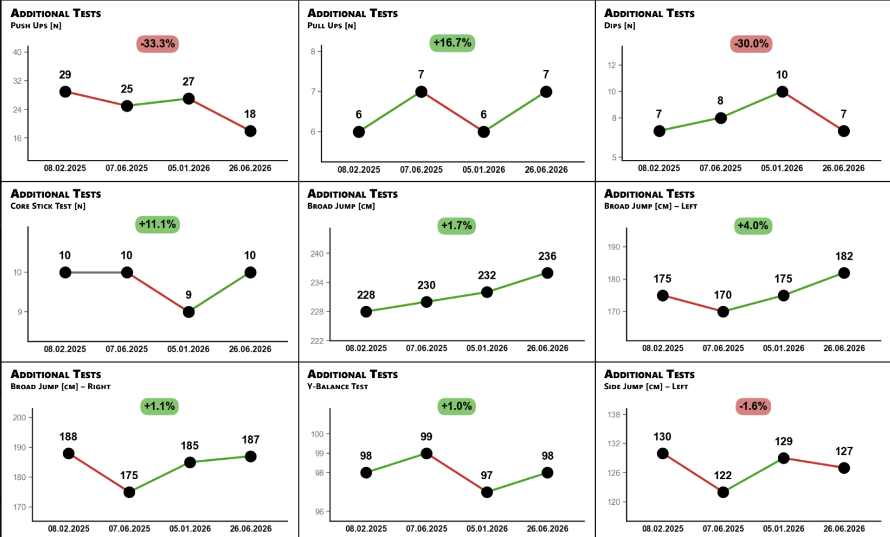
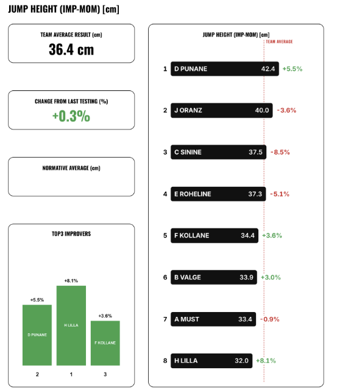
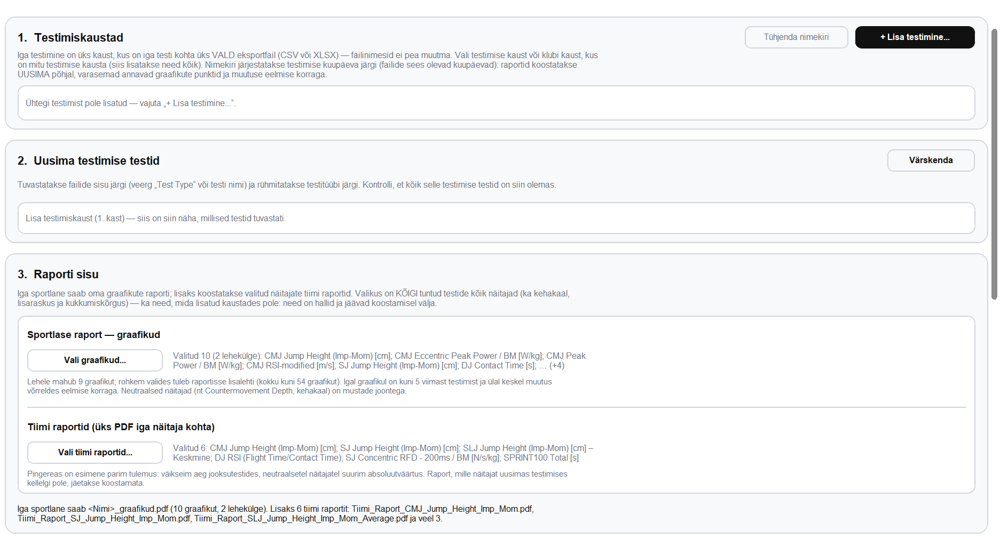
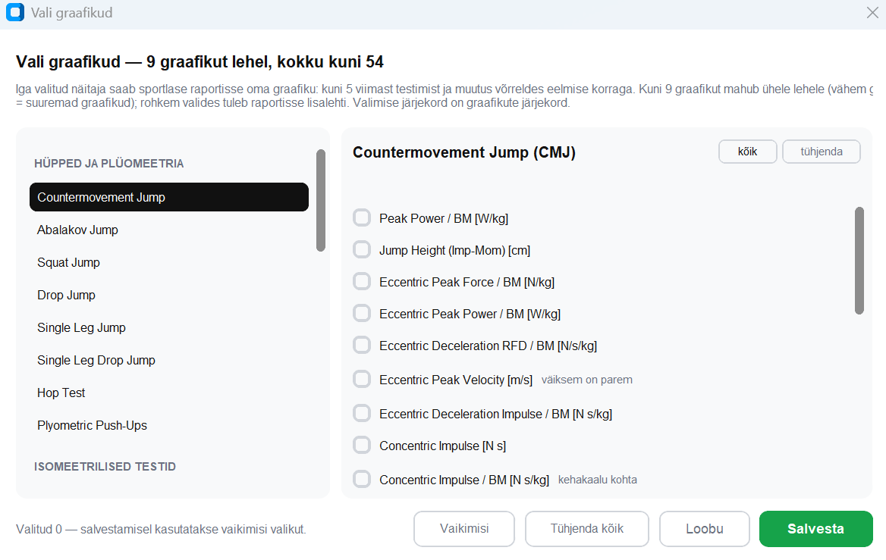
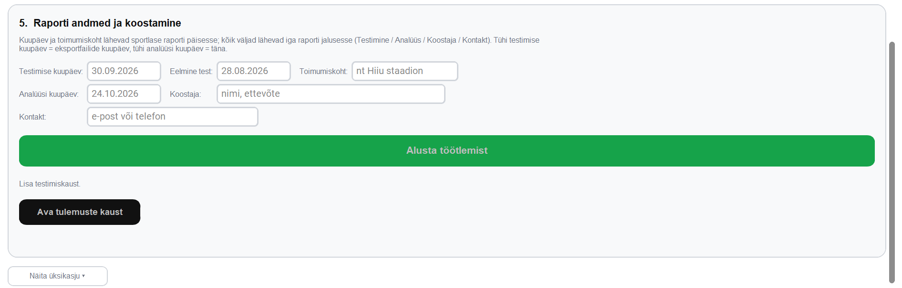

# Athlete Report Generator

A desktop app that turns raw test exports from force plates and timing gates into finished PDF reports: one for every athlete, and one page per metric for the whole team.

## Why I built it

After every testing session, someone had to go through a pile of export files, copy the numbers into charts and lay out a report for each athlete by hand. For one team that took about two hours.

With this app you add the testing folder, pick the charts you want and press one button. The reports are ready in about two minutes.

It's used after every testing session. The source code is private, so everything you see here is made with invented athletes.

## What you get

- **Athlete reports.** Nine charts per A4 page, up to six pages. Each chart shows the athlete's last five testings and how much they changed since the previous one.
 
 
- **Team reports.** One page per metric: the ranking, the team average, the change since the last testing and the top 3 improvers.
  
  
- **An Excel summary** with everyone's latest results, a short description of every metric and the full history.

## How it works

1. **You add the exports.** One CSV or Excel file per test, exactly as the testing software saves it. The app recognises the test from what's inside the file, so file names don't matter.
2. **It cleans and combines them.** It orders the testings by the dates inside the files, builds each athlete's history, converts units when an export switches between milliseconds and seconds, and fills in a missing body weight from the athlete's other tests that day. A file it can't use is skipped with a short reason instead of stopping the whole run.
3. **It knows which way is better.** For every metric the app knows whether higher, lower or neither is better. That decides the colours, the rankings and the top 3.
4. **It draws and prints.** Matplotlib draws the charts, Jinja2 fills HTML and CSS templates laid out for A4, and headless Chromium prints them to PDF.

It runs as a desktop app or from the command line, works fully offline and installs on Windows without admin rights.

**Built with** Python, pandas, NumPy, openpyxl, Matplotlib, Jinja2, HTML/CSS, Playwright with headless Chromium, CustomTkinter, PyInstaller and Inno Setup.

## The tricky parts

**Real data is messy.** One export switched from milliseconds to seconds between testings, and a perfectly normal contact time suddenly looked like a −100% change. Another ended with blank rows, which once turned into an athlete called "nan" with their own PDF and a place in the ranking. Files also came in different encodings, delimiters and date formats. The reader now handles all of it.

**Print layout has to be exact.** On a 52-chart report the grid lines between charts drifted up to a millimetre apart. Drawing each line as one page-wide element, instead of a border on every chart, fixed it.

**PDFs need tests too.** I keep a set of reports made from fixed, invented data. After every change a script rebuilds them and compares each PDF page by page (text, fonts and a pixel diff) and the Excel file cell by cell. It also runs with the network blocked, to make sure the reports never need the internet.

**Shipping to people who aren't programmers.** One script builds the Windows installer from a clean environment, bundles Chromium, checks that no source code or data slipped into the package, and runs a self-test with the finished app.

## In numbers

| | |
|---|---|
| One reporting round | about 2 hours by hand → about 2 minutes |
| Coverage | 30 tests, 442 metrics |
| Reports | up to 54 charts per athlete, up to 40 athletes on a team page |
| App | about 9,000 lines of Python; the installer is about 138 MB and the app opens in 1–2 seconds |

## My part

I built it from start to finish: I turned the client's wishes and feedback into data rules, wrote the pipeline, turned their report design into print-ready templates, tested it on real exports and packaged it as a Windows app. I used an AI coding assistant as a pair programmer and checked its work against real exports and the regression tests.

## Code

The full source stays private because the app is in commercial use. 

## Contact

**Mikk Kaspar Piirsalu**
mkpiirsalu@gmail.com
https://www.linkedin.com/in/mikk-kaspar-piirsalu-75ba19234/

